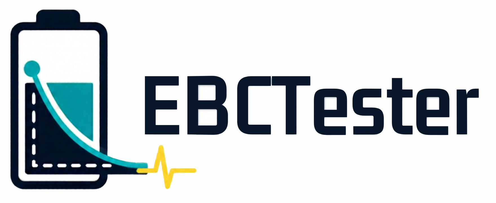
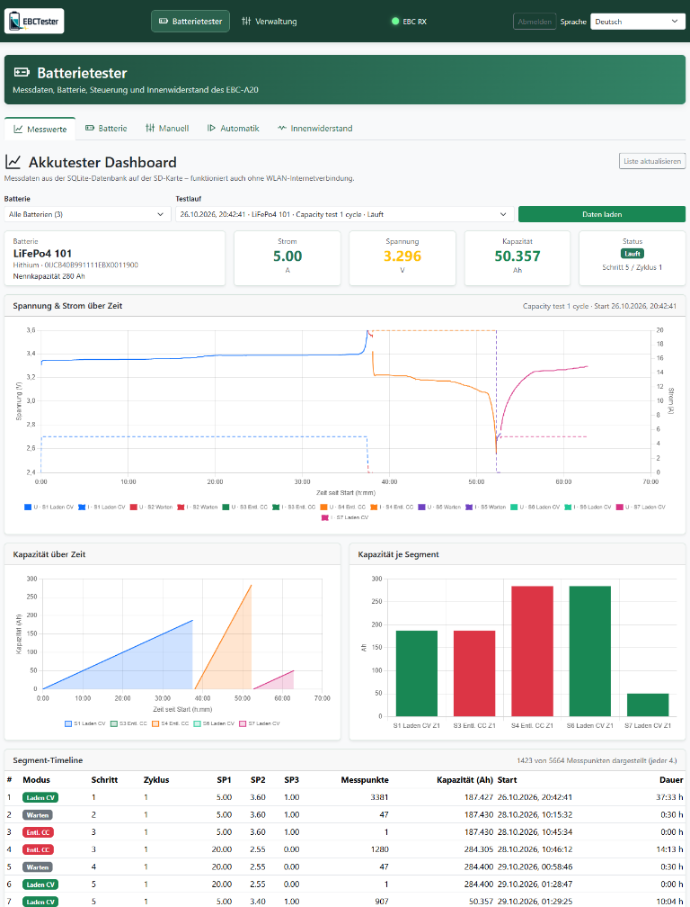
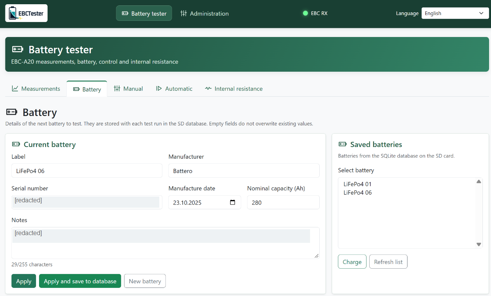
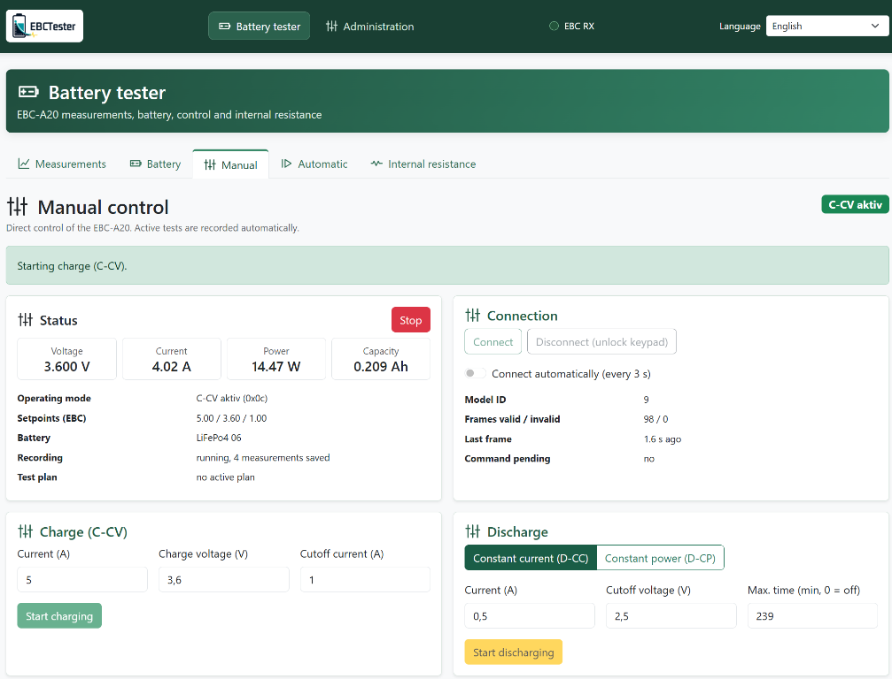
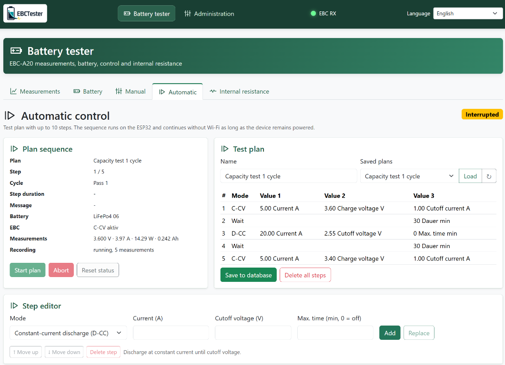
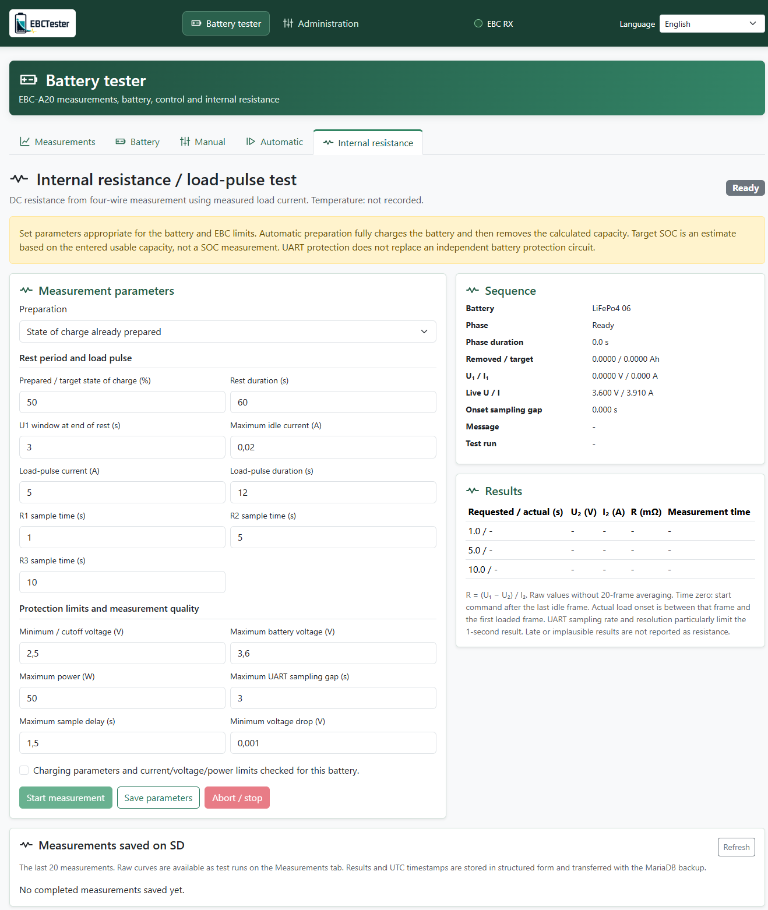
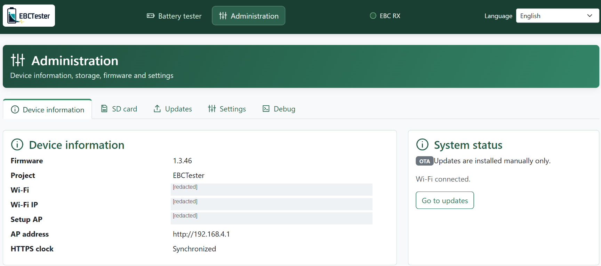
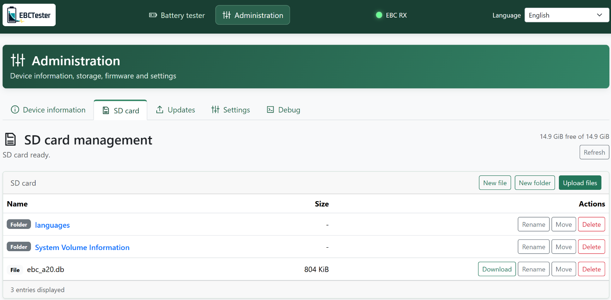
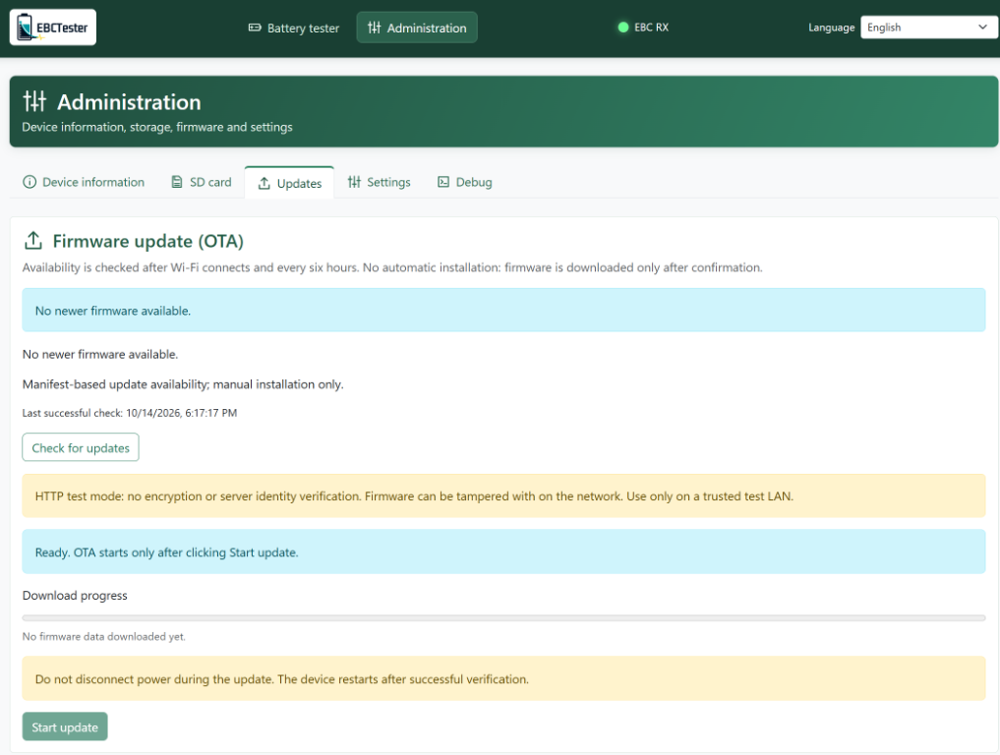
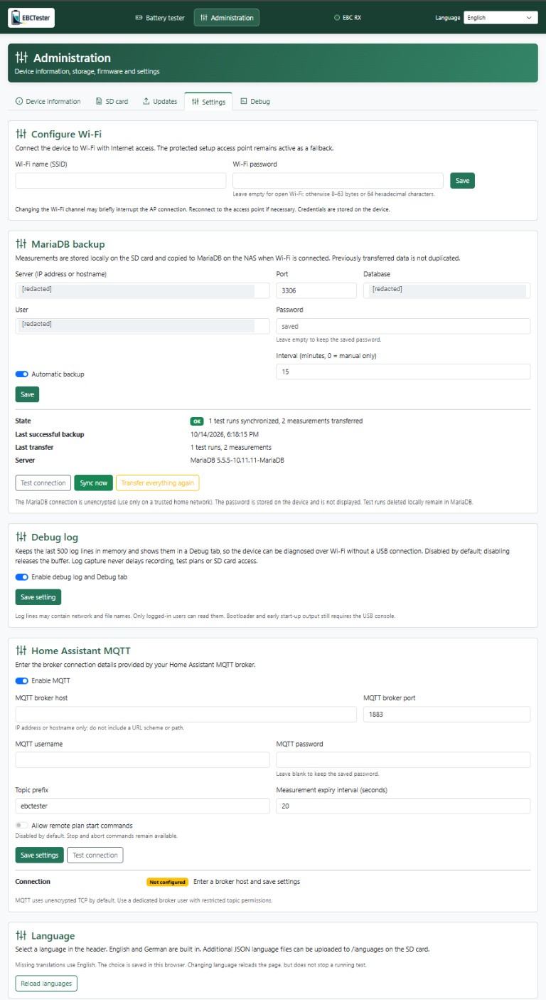

<!-- SPDX-FileCopyrightText: 2026 Thomas Stoll
     SPDX-License-Identifier: Apache-2.0 -->

# EBCTester

<p align="center">
  
</p>

**Test batteries and keep their measurements without running a PC for weeks.**

EBCTester connects supported ZKE EBC battery testers to a small ESP32-S3. The
microcontroller operates the tester, executes test plans, and records
measurements on an SD card. Its local web interface lets you manage batteries,
follow measurements, and view charts from a phone, even outside your home
Wi-Fi network.

See [CHANGELOG.md](CHANGELOG.md) for user-visible changes by firmware version.

## A look at the web interface

**Set up a test, close the browser, and come back to the results.** The ESP32
handles test execution and SD recording; the browser is your control panel,
not a requirement for keeping a test running.

### Measurements at a glance

Follow voltage, current, and accumulated capacity, then revisit saved runs.
The dashboard combines time-series charts, capacity per segment, and a
segment timeline so you can see how a battery behaved throughout a test.

<p align="center">
  <a href="docs/images/dashboard.png">
    
  </a>
</p>

Click any screenshot to open the full-size image. Expand the sections below
for a tour of the other pages. Screenshots show example settings and test
states, not recommended battery parameters; private identifiers have been
redacted.

<details>
<summary><strong>Explore battery management and test controls</strong></summary>

### Keep your batteries organized

Save battery labels, manufacturer details, nominal capacity, and notes on
the SD card. Battery details are stored with each test run, helping you
identify the cell or pack behind a set of measurements.

<p align="center">
  <a href="docs/images/battery-details.png">
    
  </a>
</p>

### Take direct control

Start constant-voltage charging or constant-current / constant-power
discharging from the browser. See live measurements, tester connection
status, and recording progress together; active tests are recorded
automatically.

<p align="center">
  <a href="docs/images/manual-control.png">
    
  </a>
</p>

### Let a plan do the repetitive work

Build and save test plans with up to ten steps, combining charge, discharge,
and rest periods. The sequence runs on the ESP32 without an open browser
or a continuous Wi-Fi connection, as long as the device remains powered.

<p align="center">
  <a href="docs/images/automatic-plans.png">
    
  </a>
</p>

### Look beyond capacity

Configure a load-pulse test to measure DC internal resistance, with separate
results at 1, 5, and 10 seconds by default. Use a battery with a prepared
state of charge or configure automatic preparation, and keep the results
on SD alongside your other tests.

<p align="center">
  <a href="docs/images/internal-resistance.png">
    
  </a>
</p>

</details>

<details>
<summary><strong>Explore storage, updates, and optional integrations</strong></summary>

### Check the device at a glance

View the installed firmware version, Wi-Fi status, access point details,
and clock synchronization from the administration section.

<p align="center">
  <a href="docs/images/device-information.png">
    
  </a>
</p>

### Access your files without removing the card

Browse SD folders, upload language files, and download files through the
web interface. Measurements stay in the local SQLite database on the SD
card, without requiring a cloud service.

<p align="center">
  <a href="docs/images/sd-card.png">
    
  </a>
</p>

### Update when you choose

Check for firmware updates and follow download progress in the browser.
Installation requires an explicit action and confirmation; updates are
never installed automatically. The screenshot shows HTTP test mode;
use HTTPS for normal firmware distribution.

<p align="center">
  <a href="docs/images/firmware-updates.png">
    
  </a>
</p>

### Add conveniences without making them dependencies

Configure Wi-Fi, optional MariaDB backups, the live debug log, and optional
Home Assistant MQTT integration in one place. MQTT provides live values
and control, not a copy of the SD database; remote plan start is disabled
by default. English and German are built in, with additional languages
loadable from SD.

<p align="center">
  <a href="docs/images/settings.png">
    
  </a>
</p>

</details>

## EBC model support

Select and save the tester under **Administration > Settings > EBC tester**
before connecting. The saved model appears beside the logo and in the control
headings even while disconnected. Its charge voltage/current, discharge
voltage/current, and constant-power limits apply to manual commands, plans,
and internal resistance settings, so plans and parameters can be prepared
without a connected tester.

The selection persists across restarts. On first installation or upgrade from
automatic model detection, select the model once; there is no assumed default.
Changing it is blocked during an operation, plan, or recording and disconnects
an idle tester. Existing plans and parameters are preserved and checked against
the selected limits when saved or started.

Status-frame identifiers are normalized as the raw byte modulo 100. Firmware
version is decoded from bytes 10 and 11 only for status bytes of at least 100,
then cached for that connection. A mismatch between two supported selected
models displays an error, disconnects the tester, discards pending commands,
and blocks automatic reconnection. Recognized disabled models and unknown
identifiers remain available as read-only telemetry; all control commands are
blocked for them.

All ZKE models in the table below are recognized. Only EBC-A20, EBC-A40L, and
EBC-A50L are currently selectable and enabled; the other known models remain
read-only until their functionality has been confirmed. If you have one of
these models and can verify its operation with EBCTester, please share your
results so it can be considered for enablement.

| Model | Ident (decimal / hex) | Firmware version | Enabled |
| --- | --- | --- | --- |
| EBC-A05+ / EBC-A05 | 5 / `0x05` | 302 / other | No |
| EBC-A10+ / EBC-A10H | 6 / `0x06` | 310 / other | No |
| EBC-A20+ / EBC-A20 | 9 / `0x09` | 311 / other | Only EBC-A20 |
| EBC-A50L / EBC-A40L | 10 / `0x0A` | 311 / other | Yes |
| EBD-M10 / EBD-A10H | 20 / `0x14` | 310 / other | No |
| EBD-M03+ / EBD-M05 / EBD-M03 | 25 / `0x19` | 310 / 315 / other | No |
| EBD-A100L / EBC-A100L / EBD-A100 | 38 / `0x26` | 310 / 311 / other | No |

EBC-A40L and EBC-A50L share ident 10 and are separated by firmware version.
If version is not yet known, the UI shows **EBC-A40L/A50L (Version unknown)**
and uses conservative A40L limits until the next version-bearing frame.
EBC-A20 (18 V / 5 A charge, 30 V / 20 A discharge, 85 W), EBC-A40L
(5 V / 40 A, 200 W), and EBC-A50L (5 V / 50 A, 250 W) remain enabled.
The existing A40L settings value 16 is retained for compatibility; the actual
protocol ident is decimal 10 (`0x0A`).

The protocol encodes setpoints in two base-240 bytes, with current and voltage
setpoints sent in 0.01-unit increments. The numeric range is sufficient for
50 A, but the 10 mA current resolution has not yet been verified on real A50L
hardware. The application does not store a battery-chemistry selection; for
the 5 V models, select settings appropriate for a lithium cell and verify them
against the connected battery before starting.

## Why this project?

ZKE devices are useful and affordable for hobbyists, but their hardware and PC
software are getting older. From my perspective, the software no longer
receives substantial development. Because it is proprietary, I cannot add the
features I need myself.

I wanted a more convenient way to store measurements. The biggest drawback,
however, was having to keep a PC connected throughout a test. Battery tests
can take days or weeks, leaving my laptop tied to the tester instead of
available for other work.

With EBCTester, I can implement the features I want without waiting for the
manufacturer. Storing measurements in a database provides a foundation for
future comparisons across batteries and additional export formats.

Optional MariaDB synchronization allows large datasets to be archived outside
the SD card. After verifying a backup, local runs can be deleted deliberately
without losing their external copies. The software **does not delete local
data automatically**.

I started with ESPHome, but some of my batteries are outside the range of my
home Wi-Fi. I needed a standalone solution that keeps recording there and
can still be operated from a phone through its own Wi-Fi access point.

-- **Thomas Stoll**

## Available features

- **No continuously running PC:** Manual operations and automatic charge/
  discharge plans run on the ESP32-S3. The browser can be closed.
- **Offline recording:** SQLite on a FAT32 SD card. Recording needs a ready
  SD database, not a home Wi-Fi connection.
- **Browser interface:** Local Bootstrap UI, battery details, charts, and
  separate testing and administration sections. CSS, JavaScript, and Chart.js
  are served by the device, without a CDN.
- **Internal resistance:** Configurable load-pulse test with separate results
  at 1, 5, and 10 seconds by default, using measured current. Supports an
  already prepared state of charge or automatic preparation.
- **Optional MariaDB backup:** Transfers test runs and structured resistance
  results to an external database.
- **Optional Home Assistant MQTT:** Publishes committed measurements and
  accepts validated plan/battery selection and control commands. Remote plan
  start requires an explicit opt-in and is disabled by default. Broker
  connection details are entered after installation in the device web UI.
- **UI languages:** English and German, with English fallback; additional
  translation files can be loaded from SD.
- **Optional live log over Wi-Fi:** A **Debug** tab shows the last 500 log
  lines in the browser, so the device can be diagnosed without a USB cable.
  Disabled by default and switched on in **Settings → Debug log**.
- **Manual updates:** New firmware is offered, but installation requires a
  button click and confirmation.

**Current version:** [](https://github.com/Gemelon/EBCTester/releases/latest), developed with ESP-IDF 6.0.1 for ESP32-S3.
EBC-A20, EBC-A40L, and EBC-A50L are currently enabled for selection and
control. Other models in the table are recognized but await functional
verification before they can be enabled. Additional export formats and
cross-battery analysis are possible extensions, not completed features.

## Architecture and reuse

The application is divided into functional components. The main program
remains small and initializes services; implementation belongs in the modules.

Two packages are independent repositories so networking, updates, and SD
management can be reused in other projects without rewriting them:

| Repository | Responsibility |
| --- | --- |
| [EBCTester](https://github.com/Gemelon/EBCTester) | Battery control, test plans, recording, charts, DCIR, and MariaDB backup |
| [ota-suite](https://github.com/Gemelon/ota-suite) | Wi-Fi provisioning, manual OTA, shared web UI, localization, and status LED |
| [sd-card-manager](https://github.com/Gemelon/sd-card-manager) | SDMMC/SPI, card detection, shared storage locking, and file management |

The packages are **pinned Git submodules** under `external/`. SD Card Manager
uses OTA Suite's web interface. OTA Suite itself needs neither EBCTester nor SD.

| Application component | Responsibility |
| --- | --- |
| `ebc_link` | UARTs, frame parser, and tester communication |
| `test_control` / `test_store` | Controls, plans, batteries, and recording |
| `resistance_test` | DCIR preparation, load pulse, and evaluation |
| `sqlite3` / `battery_database` | SQLite adapter, SD VFS, and schema |
| `battery_dashboard` | Measurements and local charts |
| `mariadb_sync` | Incremental external backup |
| `ui_localization` | Additional SD language files |
| `debug_log` | In-memory log ring buffer and the Debug tab |

See the [technical reference](docs/TECHNICAL_REFERENCE.md) for endpoints,
state transitions, and detailed parameters. Development content is always
English; explicitly requested UI translations remain available. See
[AGENTS.md](AGENTS.md).

## Quick start

No build environment needed: download `EBCTester-<version>-full-install.bin`
from the [latest release](https://github.com/Gemelon/EBCTester/releases/latest)
and flash it at address `0x0`. Instructions are in the release notes.
To build from source, see below.

## Using and compiling the project

### Requirements

- ESP32-S3 with **16 MiB flash**, such as N16R8. Defaults enable optional
  octal PSRAM; other boards require matching settings.
- ZKE EBC-A20 with suitable **3.3 V / 5 V TTL level shifting**.
  ESP32 GPIOs are not 5 V tolerant.
- FAT32 SD card, compatible wiring, and appropriate pull-ups.
- VS Code with the ESP-IDF extension, ESP-IDF **6.0.1**, and Git.
- Internet for the first build to obtain managed components and the
  hash-verified SQLite archive. The installed UI works offline.

### Download

The three repositories are public. Include their submodules; a ZIP download
alone does not contain the package checkouts:

```powershell
git clone --recurse-submodules https://github.com/Gemelon/EBCTester.git
```

For an existing checkout:

```powershell
git submodule update --init --recursive
```

Do not use `git submodule update --remote` without reviewing the changes.
The parent repository records the tested package commits.

### Configure hardware and build

1. Open the project in VS Code and select the ESP-IDF environment.
2. Select target **esp32s3**.
3. Review board, flash, PSRAM, SD mode, and UART pins in menuconfig.
4. Compile using **ESP-IDF: Build your project**.
5. For initial installation, flash bootloader, partition table, and
   application over USB. **The partition table requires 16 MiB flash.**

The optional dev container also uses IDF 6.0.1. `sdkconfig.defaults` provides
portable defaults; an existing local `sdkconfig` takes priority.
`dependencies.lock` pins managed dependencies. `OTA_SUITE_DIR` and
`SD_CARD_MANAGER_DIR` can select alternative component checkouts.

**Building does not flash the device or start a battery test.**
A changed partition table cannot be installed through OTA. Back up settings
and data before repartitioning.

### Default connections

The [EBCTester hardware schematic (PDF)](docs/EBCTester.pdf) documents the
board wiring. The editable KiCad schematic, PCB layout, and bill of materials
are maintained in a separate hardware repository that is still under
development and is currently accessible only to collaborators. The PDF
included here is a publicly available documentation snapshot.

| Connection | TX | RX | Settings |
| --- | ---: | ---: | --- |
| UART1 to tester | 17 | 18 | 9600 baud, 8O1 |
| UART2 to PC dongle | 8 | 9 | 9600 baud, 8O1 |

The dongle bridge is **not implemented yet**. UART2 is initialized, but traffic
is not forwarded to the manufacturer's software.

| SD signal | SDMMC GPIO |
| --- | ---: |
| CLK / CMD | 14 / 15 |
| D0 / D1 / D2 / D3 | 2 / 4 / 5 / 6 |
| Card detect | 7, active HIGH |

SPI is selectable: MISO 2, MOSI 15, CS 6, CLK 14. Both modes default to 10 MHz
and configurable pins. Cards are **never formatted automatically**; exFAT is
unsupported. The optional WS2812 LED defaults to GPIO 48; some boards need 38.

### First access and daily operation

1. Start the device and read the AP/admin password from the serial log.
   Without a configured password, a random one is generated once.
2. Connect a phone or computer to `BatteryTester-XXXXXX`.
3. Open `http://192.168.4.1` and log in as `admin` with the AP password.
4. Optionally configure home Wi-Fi. Local operation and recording do not
   require that connection.
5. Insert a FAT32 card, check database readiness, create a battery, and connect
   the tester. Only then start a measurement or plan.

The **Battery tester** section contains Measurements, Battery, Manual,
Automatic, and Internal resistance. **Administration** contains Device
information, SD card, Updates, and Settings.

Under **Administration → Settings → Login duration**, choose **Daily (24 hours)**
or **Weekly (7 days)**. Daily is the default. The duration starts at login,
does not renew with activity, and applies to new logins after saving. The browser
remembers the session across browser restarts unless cookies are cleared.
A device restart or **Log out** ends the session; recording and test plans continue
independently of browser login.

Saving device settings asks for the AP/admin password by default, including
Wi-Fi, login duration, debug logging, MariaDB and MQTT settings. Canceling the
prompt or entering an incorrect password does not save changes. Disable this
additional confirmation at build time with
`CONFIG_OTA_SUITE_WEB_SETTINGS_REQUIRE_PASSWORD=n` under **OTA Suite web interface**
in `menuconfig`. Login and CSRF protection remain mandatory. Test controls,
OTA actions, SD operations, and the browser-only language selection do not
require this additional password.

Plans support D-CC, D-CP, C-CV, waits, and repetitions. After a restart, an
interrupted plan is not resumed blindly. Stop and Abort remain available;
conflicting start actions are blocked.

### Data, backup, and languages

The local database is `/sdcard/ebc_a20.db`. Schema and integrity are checked
when opened. A missing card does not block the web interface, but recording
requires a ready database. Invalid database files are preserved, not silently
overwritten.

MariaDB is optional and initially disabled. Configure host and credentials
under Settings; transfer requires network access. Base tables from migrations
001-005 must already exist. This repository includes
[migration 006 for DCIR results](sql/006_resistance_results_mariadb.sql),
**not a complete initial MariaDB schema**. Delete local runs only after
verifying their backup; external copies remain.

English and German are built in. Copy the
[English template](sd_card/languages/en-custom.json) or
[Filipino test catalog](sd_card/languages/fil.json) to `/languages/` on the SD
card, reload languages, and select one. Missing keys fall back to English.
Switching language reloads the page and loses unsaved forms, but does not
stop a running test.

## Updates and publishing firmware

Automatic availability checks download only the manifest. Installation is
manual after confirmation. HTTPS validates certificates; HTTP requires
explicit opt-in for a trusted test network. Size, SHA256, and image metadata
are checked before boot selection. Rollback protects a pending image that
does not survive its startup window.

The default manifest address is a placeholder. Set your HTTPS URL in
menuconfig under **OTA Suite update checks**.

Firmware publishing is disabled in a fresh checkout. To enable SFTP, create the
Git-ignored `CMakeUserConfig.cmake`:

```cmake
set(EBCTESTER_PUBLISH_FIRMWARE ON)
set(EBCTESTER_PUBLISH_DIR "")
set(EBCTESTER_PUBLISH_ORIGIN "https://updates.example.org")
set(EBCTESTER_PUBLISH_URL_PATH "/BatteryTester")
set(EBCTESTER_SFTP_UPLOAD ON)
set(EBCTESTER_SFTP_HOST "sftp.example.org")
set(EBCTESTER_SFTP_USER "firmware")
set(EBCTESTER_SFTP_REMOTE_DIR "/public/firmware")
```

After reconfiguration, successful builds publish a versioned image, the
compatibility name, and finally an atomic `firmware.json`. With SFTP enabled
and an empty `EBCTESTER_PUBLISH_DIR`, files are prepared automatically in
`build/firmware-publication`; no NAS or network drive is needed.
Published versions cannot be replaced with different bytes:
**increase the version first**. Publication errors fail the step.

SFTP is optional and runs after local preparation. For local-only publication,
disable SFTP and set `EBCTESTER_PUBLISH_DIR` to an existing writable directory.
Install the OpenSSH client,
add the server's verified host key to `known_hosts`, and make the SSH key
available through `ssh-agent` (or your default SSH key). Passwords are never
stored in the project or passed on the command line. The remote destination
directory must already exist and be served at the configured origin and URL
path. SFTP transfers the immutable versioned BIN, compatibility BIN, license
bundle, and finally the manifest; an existing versioned BIN is downloaded and
hash-checked before the upload, and different bytes are rejected.

Publishing copies license documentation before the image to
`licenses/EBCTester-<version>/`. Missing documents fail the step.
**Distribute the complete license directory with firmware**, not just `.bin`.
The OTA manifest format is unchanged. See
[third-party notices](THIRD_PARTY_NOTICES.md).

## Limitations, safety, and contributions

- Independent hobby project, **not an official ZKE product** or a claim of
  manufacturer support.
- Battery settings and protection limits must match chemistry, wiring, and
  equipment ratings. Software does not replace hardware protection.
  Long-running tests are not automatically safe to leave unattended.
- The local server uses cookie-based sessions over unencrypted HTTP. Use only
  a trusted LAN or protected AP; never expose it to the internet. HTTP exposes
  both passwords and session cookies to network interception.
- MariaDB uses unencrypted TCP. NVS/flash are not encrypted by default;
  protect passwords and serial access.
- SHA256 is not a signature. Secure Boot, signed firmware, and flash/NVS
  encryption are separate deployment decisions.
- UTC timestamps need valid device time. Without it, uptime-based recording
  is available; timestamps are not fabricated.
- Check SD cards, power, and backups. No guarantee of measurement accuracy,
  loss-free storage, or fitness for a particular purpose.

Reports and contributions are welcome. Include board, firmware version,
reproduction steps, and sanitized logs. Never publish passwords, tokens, or
private measurements in issues or commits. Test changes to protocol, schema,
and safety limits. Mark redistributed modified Apache-covered files and
preserve copyright/license notices.

## Tests

Host tests require Node.js, Python, and CMake for publishing; no additional
Node packages:

```powershell
node --test tests\dashboard.test.js tests\web_interface.test.js tests\web_auth_ui.test.js tests\publication.test.js tests\ui_languages_test.js
python tests\resistance_schema_test.py
python tests\web_auth_test.py
python tests\license_metadata_test.py
```

Set `CMAKE_EXE`, `OTA_SUITE_DIR`, and `SD_CARD_MANAGER_DIR` if needed.
Authentication tests require restored managed dependencies and a host C compiler
(`CC`, `cl` in a Visual Studio developer shell, or `cc`). They run with password
confirmation both enabled and disabled, without contacting or flashing hardware.
Native manifest/DCIR tests and hardware checks are described in the
[technical reference](docs/TECHNICAL_REFERENCE.md).
`python tests\ui_language_fixture.py` serves simulated browser data only;
it does not operate hardware.

## License and authorship

**Copyright 2026 Thomas Stoll.** Original code and documentation in EBCTester,
OTA Suite, and SD Card Manager are licensed under
**[Apache License 2.0](LICENSE)**. Commercial use, changes, and sale are
permitted under its terms. Its warranty and liability disclaimers apply.
It does not grant rights to third-party trademarks.

[NOTICE](NOTICE) contains project attribution. Source files have SPDX
copyright/license headers; commentless formats are covered by
[.reuse/dep5](.reuse/dep5). This does **not** relicense third-party code.

## Third-party components and licenses

This project builds on others' work. Their copyrights, license texts, and
disclaimers remain intact; dependencies are not presented as original project
code or blanket-relicensed.

| Component | Author / origin | License and supplied notices |
| --- | --- | --- |
| Bootstrap 5.3.3 | The Bootstrap Authors | MIT - [original text](external/ota-suite/components/web_interface/assets/BOOTSTRAP-LICENSE) |
| Chart.js 4.4.9 | Chart.js Contributors | MIT - [original text](components/battery_dashboard/assets/CHARTJS-LICENSE.md) |
| @kurkle/color 0.3.2, included in Chart.js | Jukka Kurkela | MIT - [original text](components/battery_dashboard/assets/KURKLE-COLOR-LICENSE.md) |
| SQLite 3.53.4 | SQLite authors | [Public Domain](https://sqlite.org/copyright.html); separately downloaded amalgamation |
| ESP-IDF 6.0.1 | Espressif Systems and contributors | Apache-2.0 for original Espressif code; [SDK license](third_party/licenses/esp-idf/LICENSE); other SDK parts below |
| cJSON 1.7.19~2 | Dave Gamble and cJSON contributors | MIT - [original text](third_party/licenses/cjson/LICENSE) |
| led_strip 3.1.0~1 | Espressif Systems | Apache-2.0 - [original text](third_party/licenses/led_strip/LICENSE) |
| FreeRTOS-Kernel | Amazon.com and contributors | MIT - [original text](third_party/licenses/esp-idf/FreeRTOS-LICENSE.md) |
| lwIP | Swedish Institute of Computer Science and other authors | BSD-3-Clause - [original text](third_party/licenses/esp-idf/lwip-COPYING) |
| FatFs | ChaN | Custom permissive terms - [original notice](third_party/licenses/esp-idf/FatFs-NOTICE.txt) |
| Mbed TLS / TF-PSA-Crypto | Upstream authors | Apache-2.0 option where dual-licensed; [Mbed TLS](third_party/licenses/esp-idf/mbedtls-LICENSE), [TF-PSA-Crypto](third_party/licenses/esp-idf/tf-psa-crypto-LICENSE); file-specific notices apply |
| wpa_supplicant | Jouni Malinen and contributors | BSD-3-Clause - [license](third_party/licenses/esp-idf/wpa_supplicant-README), [copyright](third_party/licenses/esp-idf/wpa_supplicant-COPYING) |
| http_parser | Igor Sysoev, Joyent, and Node contributors | MIT - [original text](third_party/licenses/esp-idf/http_parser-LICENSE.txt) |
| C runtime: Newlib / Picolibc | Multiple authors | Collection of mostly permissive terms - [Newlib](third_party/licenses/esp-idf/COPYING.NEWLIB), [Picolibc](third_party/licenses/esp-idf/COPYING.picolibc) |
| GCC runtime: libgcc / libstdc++ | Free Software Foundation and contributors | GPL-3.0 with GCC Runtime Library Exception 3.1 - [GPL](third_party/licenses/toolchain/COPYING3), [exception](third_party/licenses/toolchain/COPYING.RUNTIME) |
| TLSF allocator | Matthew Conte | BSD-3-Clause - [original notice](third_party/licenses/esp-idf/TLSF-NOTICE.txt) |
| Argtable3 / linenoise | Stewart Heitmann; Salvatore Sanfilippo and Pieter Noordhuis | BSD terms - [Argtable3](third_party/licenses/esp-idf/argtable3-LICENSE), [linenoise](third_party/licenses/esp-idf/linenoise-LICENSE) |
| protobuf-c / SPIFFS, SDK components | Dave Benson and protobuf-c authors; Peter Andersson | [BSD-2-Clause](third_party/licenses/esp-idf/protobuf-c-LICENSE) / [MIT](third_party/licenses/esp-idf/spiffs-LICENSE); configuration-dependent |
| Other file-specific SDK notices | Authors credited in original headers | [Collected notices](third_party/licenses/esp-idf/SOURCE-NOTICES.txt), including BSD, MIT, and CC0; [standard texts](third_party/licenses/standard/) |

Additional unmodified SDK texts are in [third_party/licenses/](third_party/licenses/).
[dependencies.lock](dependencies.lock) records managed versions.
See [THIRD_PARTY_NOTICES.md](THIRD_PARTY_NOTICES.md) for provenance and source/
firmware distribution obligations. Review this inventory for different SDK
versions or new components; it does not replace actual upstream license texts.
